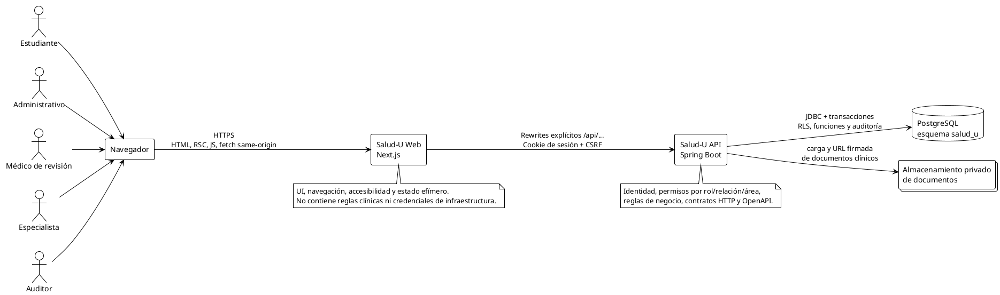
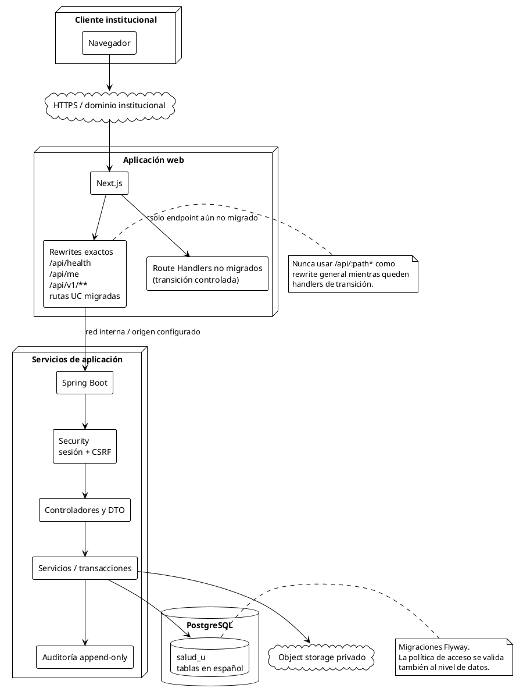
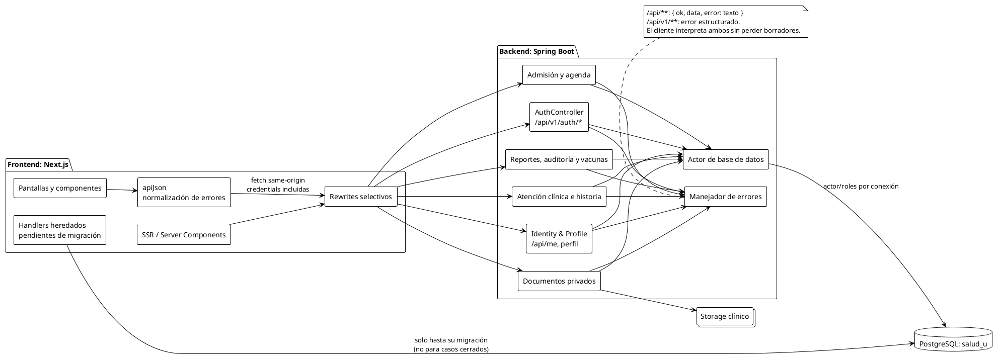
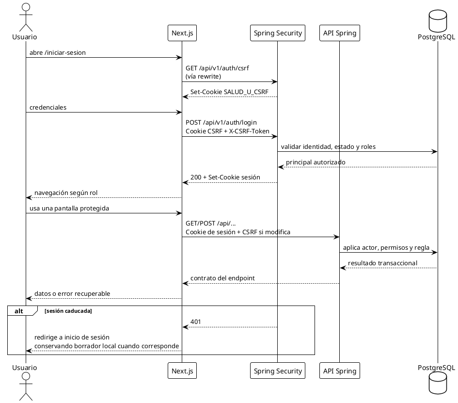
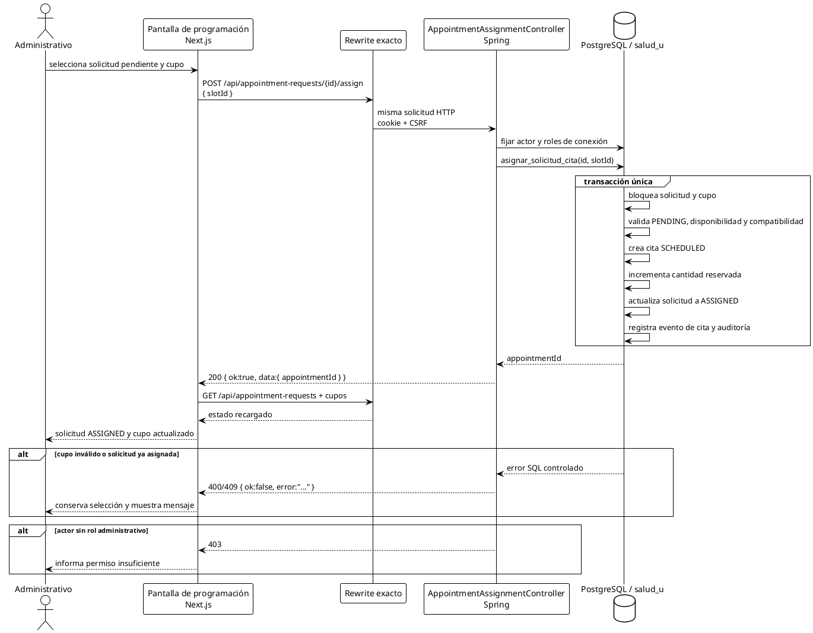

# Arquitectura objetivo: Salud-U integrado

Este documento representa el destino de integración: Next.js conserva la experiencia web y Spring Boot es la única autoridad para sesión, reglas clínicas, autorización, auditoría y persistencia. Las rutas ya migradas no llaman a Supabase; las restantes se migran de manera explícita, sin un rewrite global que capture endpoints serverless todavía vigentes.

Los bloques siguientes usan **PlantUML**. Se pueden renderizar con la extensión de PlantUML del editor o con cualquier servidor/CLI compatible.

## 1. Contexto del sistema

## 2. Despliegue y frontera de red

## 3. Componentes y responsabilidades terminadas

## 4. Secuencia de sesión y llamada autenticada

## 5. Secuencia UC-07: asignar solicitud a cupo

## Estado objetivo de migración

| Capa | Resultado esperado al cierre |
|---|---|
| Frontend | Next.js es cliente y capa de presentación; no conoce claves de base de datos ni aplica reglas clínicas. |
| API | Spring publica contratos versionados o heredados caracterizados, valida autorización y ejecuta operaciones atómicas. |
| Datos | PostgreSQL conserva UUID, FK, versiones, eventos y evidencia de auditoría con migraciones Flyway. |
| Archivos | El backend verifica contenido y autorización; el navegador recibe URLs temporales, nunca acceso directo permanente. |
| Transición | Cada endpoint pasa de handler serverless/Supabase a rewrite explícito y se elimina el handler anterior después de probarlo. |
| Observabilidad | Health apunta al backend, auditoría no contiene texto clínico sensible y los errores son compatibles con la UI. |
